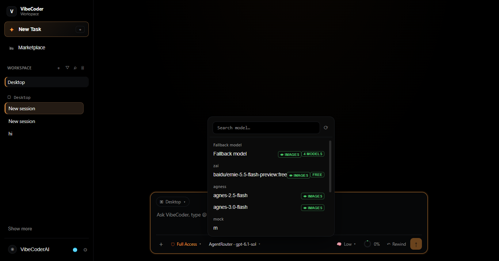

# VibeCoder AI

**A local-first AI coding workspace for Windows.** Bring your own model provider, keep your project on your machine, and let an agent plan, edit, run, verify, and rewind real work.

[Website](https://vibecoderai.onrender.com) · [Download](https://vibecoderai.onrender.com/download-page) · [Latest release](https://github.com/jhfarhanyt20-coder/VibeCoder-AI/releases/latest) · [Report a problem](https://github.com/jhfarhanyt20-coder/VibeCoder-AI/issues)


---

## Why VibeCoder AI

| | |
|---|---|
| **Your providers, your keys** | OpenAI-compatible Chat Completions, OpenAI Responses, and Anthropic Messages formats. Add any compatible endpoint, including self-hosted and keyless local servers. |
| **Fallback model** | Build one ordered chain from models across different providers. If a model is rate-limited, returns a server error, times out, is unreachable, or is blocked by its content filter, the next model answers automatically. The cursor is sticky, moves down the chain, and wraps around at the end. |
| **Real agent work** | Read and search a project, edit files, run commands, inspect diffs, verify changes, and use MCP connectors — with live tool output in the timeline. |
| **Control stays with you** | Permission prompts, hard Locks, Guardrails, and per-step Rewind snapshots. Stop a run at any time. |
| **Long sessions that continue** | Provider-aware context metering, automatic compaction, and overflow recovery. |
| **Two surfaces, one engine** | The desktop app and the full-screen `vibe` CLI share sessions, providers, tools, permissions, and history. |
| **Local-first** | No VibeCoder-hosted model service. API keys stay in the local encrypted key store; project code stays on your machine until you send it to your chosen provider. |

## Screenshots

### An agent doing real work

Read, edit, and shell steps are visible in the timeline, with the verification result and a short closing summary.


### Fallback model chain

Pick models from every provider, order them, and let VibeCoder continue when one provider stops.


### One picker for every provider

Fallback model sits above the provider list as a single selectable entry.



## Download

Windows 10 / 11, 64-bit:

- **Website:** https://vibecoderai.onrender.com/download-page
- **GitHub Releases:** https://github.com/jhfarhanyt20-coder/VibeCoder-AI/releases/latest

Installed desktop apps update through the public GitHub Release feed. Open **Settings → App Updates** and use **Check for Updates** → **Update Now** → **Install & Restart**. The manual update path works even when automatic checks/downloads are off.

## Add a provider

1. Open **Settings → Model settings**.
2. Pick a popular provider or **Add provider**.
3. Enter the API base URL and API key, then add one or more models.
4. Choose the model (or the **Fallback model** chain) in the composer.

Popular providers stay under **Popular providers** and turn green once configured; only providers you create yourself appear under **Custom providers**.

### Fallback model

Open **Settings → Model settings → Fallback model**, then:

1. Pick models from any configured provider.
2. Order them with the arrow buttons (top = first).
3. Select **Fallback model** in the composer.

Each model uses its own provider key and context window. If the active model fails, the next one answers; the position is remembered across app restarts, and **Reset to #1** is always available.

## CLI

Requires Node.js 20+:

```bash
npm install -g ./VibeCoder-CLI-<version>.tgz
cd path/to/your-project
vibe
```

The CLI calls the same SDK and tool registry as the desktop app. See the [CLI page](https://vibecoderai.onrender.com/cli) for commands, provider management, attach mode, and troubleshooting.

## Repository layout

```text
VibeCoderAI-live-fixed/   Desktop app, core engine, SDK, CLI, renderer and tests
docs/                     Screenshots and project documentation
.github/workflows/        Tag-driven Windows release workflow
```

## Development

```bash
cd VibeCoderAI-live-fixed
npm ci
npm test
npm run app
```

The test suite covers the core engine, adapters, agents, skills, harness, control, CLI, Electron IPC, UI regressions, and the updater. A release is built only from a `v*` tag and must pass the full suite.

## Project standards

- **Backward-compatible changes only.** Existing sessions, stored provider IDs, and update paths keep working.
- **No secrets in the repository.** API keys are stored locally by the app, never committed.
- **Release discipline.** One patch increment at a time, full test gate, then a tagged GitHub Release with installer, blockmap, `latest.yml`, and the CLI package.
- **Security reports.** See [SECURITY.md](SECURITY.md); please do not open a public issue for a vulnerability.
- **Contributions.** Issues and reproduction reports are welcome. See [CONTRIBUTING.md](CONTRIBUTING.md) before sending code.

## License

Proprietary software, all rights reserved. See [LICENSE](LICENSE). VibeCoder AI is a desktop workspace, not a hosted AI provider; model usage and provider terms are handled by the provider you connect.

---

If VibeCoder AI saves you time, **star the repository** so more builders can find it.
